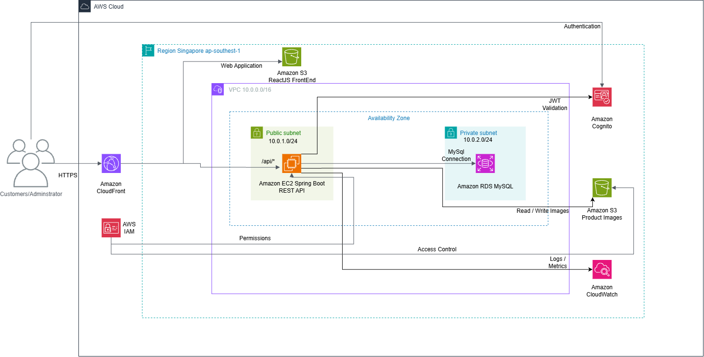

# Building a Mobile Phone E-commerce Web Application on AWS Cloud

### 1. Executive Summary

This project aims to build and deploy a mobile phone e-commerce web application on AWS for two main user groups: customers and administrators. Customers can browse products, search for phones, register, sign in, and place orders. Administrators can manage products, images, orders, and users within the application's scope.

The application uses ReactJS for its user interface, Java Spring Boot for business logic, and MySQL for data storage. On AWS, Amazon S3 and Amazon CloudFront deliver the frontend and product images; Amazon EC2 runs the application server; Amazon RDS manages the database; Amazon Cognito authenticates users; and Amazon CloudWatch monitors operations. Amazon VPC and AWS IAM provide network isolation and access control.

The goal is to deliver an online, testable phone-store application while gaining practical experience deploying a multi-component web system on AWS.

### 2. Problem Statement

**Current challenges**

A phone e-commerce application needs centralized management of products, accounts, and orders. When the application runs only on local computers, it is difficult to test Internet access, connections among components, and system operations in a realistic deployment environment.

**Proposed solution**

The team will build a system consisting of a user interface, an application server, and a database. ReactJS provides customer and administrator interfaces; Spring Boot exposes APIs and processes business operations; and MySQL stores application data. These components will be deployed on AWS and connected through appropriate networking and access permissions.

Amazon Cognito will support user registration, sign-in, and authentication. Amazon CloudWatch will be used to observe server health and application logs.

### 3. Solution Architecture

The architecture comprises the following primary components: users access the application through Amazon CloudFront; the ReactJS frontend and product images are stored in Amazon S3; business requests are routed to the Spring Boot application running on Amazon EC2; and the application connects to a MySQL database hosted on Amazon RDS. Amazon Cognito provides user authentication, while Amazon CloudWatch provides monitoring.

**AWS services used**

| Service | Purpose |
|---|---|
| Amazon VPC | Provides the network environment for the application server and database. |
| AWS IAM | Manages access permissions to AWS resources. |
| Amazon EC2 | Hosts Java Spring Boot and its APIs. |
| Amazon RDS | Hosts and manages the MySQL database. |
| Amazon S3 | Stores the built ReactJS frontend and product images. |
| Amazon CloudFront | Delivers the frontend and images and routes requests to the application server. |
| Amazon Cognito | Supports registration, sign-in, and JWT-based authentication. |
| Amazon CloudWatch | Collects metrics and logs for system monitoring. |

**Component design**

- **Frontend:** Customer and administrator interfaces use ReactJS, HTML, CSS, JavaScript, and Bootstrap. The production build is stored in S3 and delivered through CloudFront.
- **Application server:** Spring Boot runs on one EC2 instance in a public subnet, receiving business requests through CloudFront using the `/api/*` path.
- **Database:** RDS MySQL is deployed in private subnets, with database access allowed only from the application server. A Single-AZ database instance is selected for the workshop environment.
- **Product images:** Images are stored in S3 and delivered by CloudFront. The application server receives appropriate permissions to manage files.
- **Authentication and monitoring:** Cognito issues authentication tokens, which Spring Boot validates for protected requests. CloudWatch tracks EC2 metrics and application logs.

### 4. Technical Implementation

**Implementation phases**

1. Analyze the phone-store requirements and define customer functions, administrator functions, and data flows.
2. Design ReactJS interfaces, the MySQL data model, and Spring Boot APIs.
3. Configure the AWS environment, including IAM, VPC, security groups, EC2, RDS, S3, CloudFront, Cognito, and CloudWatch.
4. Deploy the frontend to S3 and CloudFront, deploy Spring Boot to EC2, connect RDS, and integrate Cognito.
5. Test website access, authentication, product management, order placement, database connectivity, and system logs.

**Team responsibilities**

| Team member | Responsibilities |
|---|---|
| Mai Văn Tường | UI design; customer and administrator ReactJS interfaces; API integration; system analysis and design. |
| Hoàng Thanh Tài | IAM, VPC, EC2, RDS, S3, and CloudFront configuration; AWS deployment; CloudWatch monitoring. |
| Kiều Minh Quang | Database design, MySQL management, data preparation, and API testing with Postman. |
| Đỗ Mạnh Long | Spring Boot development, JPA, Repository, Service, Controller, and REST APIs. |
| Dương Quang Huy | Amazon Cognito integration, registration, sign-in, JWT validation, and authorization. |

### 5. Roadmap and Milestones

- **Milestone 1 – Analysis and design:** Complete functional requirements, UI designs, the database diagram, and the AWS architecture.
- **Milestone 2 – Application development:** Complete ReactJS interfaces, Spring Boot features, the MySQL database, and authentication integration.
- **Milestone 3 – AWS infrastructure preparation:** Configure networking, permissions, compute, database, and storage resources.
- **Milestone 4 – Deployment and integration:** Deploy the frontend, backend, and database to AWS and connect all components.
- **Milestone 5 – Testing and completion:** Test functions, authentication, and database connectivity; review logs and metrics; finalize workshop documentation.

### 6. Budget Estimation

**Estimated AWS infrastructure cost for one month**

| Service / Resource | Cost (USD/month) |
|---|---:|
| Amazon EC2 and EBS storage | 21.19 |
| Amazon RDS MySQL and database storage | 21.01 |
| Amazon S3 | 0.18 |
| Amazon CloudFront | 0.00 |
| Amazon Cognito | 0.00 |
| Amazon CloudWatch | 0.00 |
| Public IPv4 address | 3.65 |
| AWS IAM and Amazon VPC | 0.00 |
| **Total estimated cost** | **46.03 USD/month** |

### 7. Risk Assessment

**Risk matrix**

| Risk | Impact | Likelihood |
|---|---|---|
| Incorrect networking or access permissions prevent components from connecting | High | Medium |
| Application server or database interruption during testing | Medium | Medium |
| Authentication or authorization configuration errors | High | Medium |
| Actual costs exceed estimates or available credits are insufficient | Medium | Medium |

**Mitigation strategies**

- Validate network rules and permissions step by step; permit database connections only from the application server.
- Test functions and component connectivity after each deployment phase; inspect logs and metrics in CloudWatch.
- Validate JWTs and enforce appropriate customer and administrator permissions.
- Track costs in AWS Billing and remove resources that are no longer needed.

**Contingency plan**

- If a service fails, inspect the logs and configuration, then restart the relevant component when appropriate.
- Maintain source code and essential database backups to restore the workshop environment.

### 8. Expected Outcomes

- A working mobile phone e-commerce web application with customer and administrator interfaces.
- Successful deployment of ReactJS on S3 and CloudFront, Spring Boot on EC2, and MySQL on RDS.
- Cognito-based registration, sign-in, authentication, and authorization.
- Verified workflows for browsing products, managing products, placing orders, and persisting data.
- Visibility into application logs and server health through CloudWatch.
- Completed workshop documentation including an architecture diagram, deployment steps, testing screenshots, and resource clean-up instructions.
