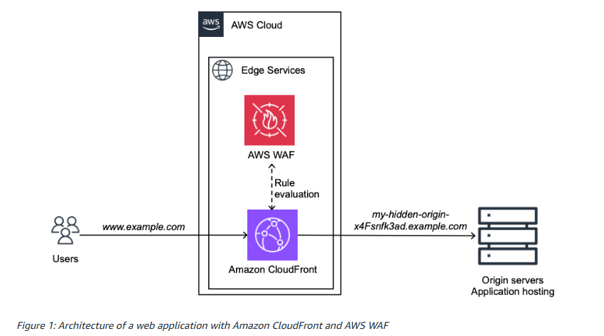

# BLOG 2: Accelerating and securing your website with Amazon CloudFront and AWS WAF

This AWS blog post explains how to combine Amazon CloudFront and AWS Web Application Firewall (WAF) to improve performance and enhance security for web applications. Websites often face challenges such as slow page load times, sudden spikes in traffic, and the risk of cyberattacks. AWS recommends using CloudFront to optimize content delivery, and AWS WAF to monitor and block malicious requests before they reach your servers.

**Key points to know:**

* Amazon CloudFront is a Content Delivery Network (CDN) service that facilitates the delivery of website content through a global network of Edge Locations.

* Edge Locations bring content closer to users, reducing latency and improving page load speeds.

* Caching allows CloudFront to store content temporarily, decreasing the number of requests sent to the Origin Server.

* A CloudFront Distribution manages content delivery configurations, including Origins, Cache Behaviors, and related policies.

* AWS WAF protects web applications against threats such as SQL injection, malicious bots, and various forms of HTTP-based attacks.

* A Web Access Control List (Web ACL) enables the definition of rules to inspect, block, or limit incoming access requests.

* AWS Managed Rules provide pre-configured security rules designed to detect common threats.

* Amazon CloudWatch and AWS WAF Logs facilitate the monitoring of system performance, traffic, and security-related activity.

Combining Amazon CloudFront and AWS WAF helps websites improve response speeds, reduce server load, and strengthen defenses against malicious requests. This is a key solution for building web applications on the AWS platform that offer high performance, high availability, and robust security.

**Website architecture diagram incorporating Amazon CloudFront and AWS WAF**

**Original article link:**https://aws.amazon.com/vi/blogs/networking-and-content-delivery/accelerate-and-protect-your-websites-using-amazon-cloudfront-and-aws-waf/

