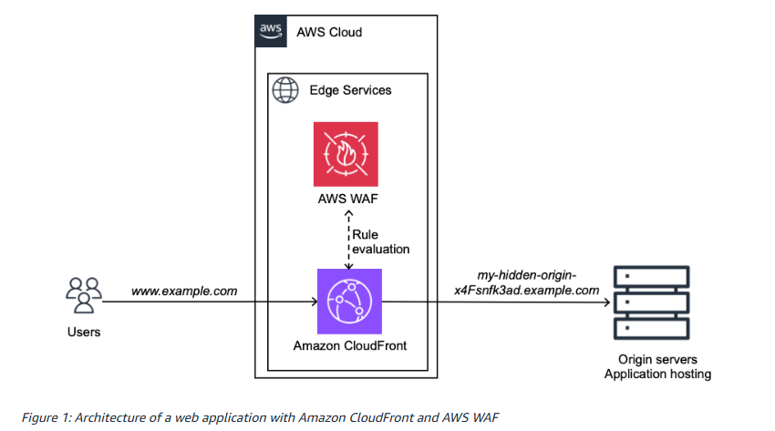

# BLOG 2: Tăng tốc và bảo mật website với Amazon CloudFront và AWS WAF

Bài blog từ AWS giới thiệu cách kết hợp Amazon CloudFront và AWS Web Application Firewall (WAF) để cải thiện hiệu suất và tăng cường bảo mật cho các ứng dụng web. Trong quá trình hoạt động, website thường gặp những vấn đề như thời gian tải trang chậm, lưu lượng truy cập tăng đột biến và nguy cơ bị tấn công mạng. AWS đề xuất sử dụng CloudFront để tối ưu quá trình phân phối nội dung và AWS WAF để kiểm soát, ngăn chặn các yêu cầu độc hại trước khi chúng tiếp cận máy chủ.

**Các điểm chính cần nắm:**

* Amazon CloudFront là dịch vụ Content Delivery Network (CDN), giúp phân phối nội dung website thông qua mạng lưới Edge Locations toàn cầu.

* Edge Locations đưa nội dung đến gần người dùng hơn, giúp giảm độ trễ và cải thiện tốc độ tải trang.

* Caching cho phép CloudFront lưu trữ nội dung tạm thời, giảm số lượng yêu cầu gửi đến Origin Server.

* CloudFront Distribution quản lý cấu hình phân phối nội dung, bao gồm Origins, Cache Behaviors và các chính sách liên quan.

* AWS WAF bảo vệ ứng dụng web trước các mối đe dọa như SQL Injection, bot độc hại và một số hình thức tấn công HTTP.

* Web Access Control List (Web ACL) cho phép thiết lập quy tắc kiểm tra, chặn hoặc giới hạn yêu cầu truy cập.

* AWS Managed Rules cung cấp các quy tắc bảo mật được quản lý sẵn, hỗ trợ phát hiện những mối đe dọa phổ biến.

* Amazon CloudWatch và AWS WAF Logs hỗ trợ theo dõi hiệu suất, lưu lượng truy cập và hoạt động bảo mật của hệ thống.

Việc kết hợp Amazon CloudFront và AWS WAF giúp website nâng cao tốc độ phản hồi, giảm tải cho máy chủ và tăng khả năng phòng vệ trước các yêu cầu độc hại. Đây là giải pháp quan trọng trong việc xây dựng các ứng dụng web có hiệu suất tốt, tính sẵn sàng cao và khả năng bảo mật hiệu quả trên nền tảng AWS.

**Sơ đồ kiến trúc website kết hợp Amazon CloudFront và AWS WAF**

**Link bài gốc:**https://aws.amazon.com/vi/blogs/networking-and-content-delivery/accelerate-and-protect-your-websites-using-amazon-cloudfront-and-aws-waf/

